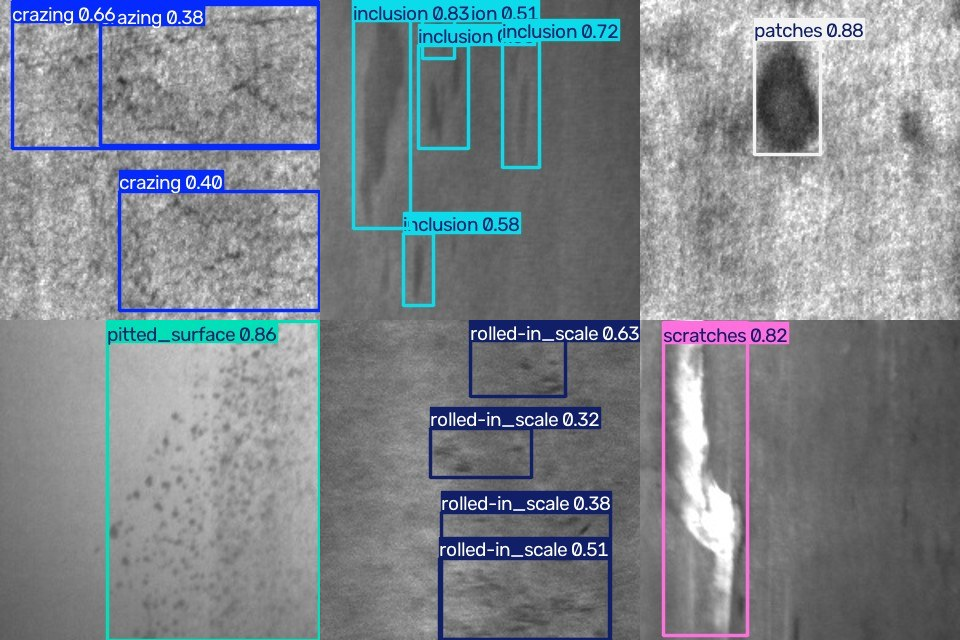

# Steel Defect Detection API

A computer-vision service that finds surface defects on hot-rolled steel. A YOLO26n
model is fine-tuned on the NEU-DET industrial dataset and served behind a tested,
containerised REST API, with CI on every push and a Docker image published on every release.




*Predictions on six images from the held-out test split, one per defect type.*

## The problem

In steel production, surface defects such as scratches, inclusions and scale are
still often found by people watching a line. This project detects and localises six
defect types automatically, returning each defect's type, confidence and bounding
box so a downstream system can flag, sort or log the part.

| Class | What it looks like |
|---|---|
| `crazing` | Network of fine surface cracks |
| `inclusion` | Foreign material embedded in the surface |
| `patches` | Irregular discoloured areas |
| `pitted_surface` | Small pits and holes |
| `rolled-in_scale` | Oxide scale pressed into the surface during rolling |
| `scratches` | Linear marks |

## Results

Measured on the **held-out test split** (180 images), which was not used for training
or for picking the best epoch.

| Metric | Score |
|---|---|
| **mAP50** | **0.758** |
| mAP50-95 | 0.456 |
| Precision | 0.722 |
| Recall | 0.722 |
| Model size | 5.5 MB |
| Inference | ~50 ms per request on an Apple M3 laptop, including image decoding |

| Class | mAP50 | |
|---|---|---|
| scratches | 0.973 | Very reliable |
| patches | 0.904 | |
| inclusion | 0.848 | |
| pitted_surface | 0.812 | |
| rolled-in_scale | 0.657 | Low contrast, often confused with background |
| crazing | 0.354 | Weakest: fine crack networks with no clear boundary |

**Crazing is the weak spot,** and that's a known problem with NEU-DET. Its "defects"
are diffuse textures rather than objects with edges, and the annotated boxes vary a
lot between images. Larger models, higher input resolution or texture-focused
augmentation would be the next things to try.

Full numbers are in [`models/metrics.json`](models/metrics.json), and the API serves
them at `GET /model`.

## How it works

```
scripts/download_data.py   download NEU-DET (YOLO format) from Hugging Face
scripts/train.py           fine-tune YOLO26n, evaluate on the test split
scripts/make_demo.py       render docs/predictions.jpg
app/model.py               load weights, validate images, run inference
app/main.py                FastAPI application and endpoints
models/                    trained weights + test metrics (served by the API)
tests/                     pytest suite, run on every push
Dockerfile                 CPU-only production container
.github/workflows/ci.yml   lint, test, build and smoke-test the image
.github/workflows/release.yml   on a GitHub release: run CI, then publish the image
```

**Training.** The model starts from COCO-pretrained YOLO26n weights and is fine-tuned
on 1,437 training images. The best epoch is chosen on the 180-image validation split,
and the final numbers come from the separate 180-image test split, so the reported
scores are not tuned on the data they're measured on.

**Serving.** `app/model.py` is the only module that knows about YOLO. The API calls
`load()`, `detect()` and `annotate()`, so a different detector can be swapped in
without touching `main.py`.

## Endpoints

| Method | Path             | Purpose                                     |
|--------|------------------|---------------------------------------------|
| GET    | `/health`        | Liveness check for Docker and orchestrators |
| GET    | `/model`         | Served model, classes and test metrics      |
| POST   | `/predict`       | Detect defects, return JSON                 |
| POST   | `/predict/image` | Detect defects, return the image with boxes |
| GET    | `/docs`          | Interactive OpenAPI docs                    |

Both prediction endpoints accept an optional `conf` query parameter (0.01 to 1.0,
default 0.25) that sets the minimum confidence.

### Example

```bash
curl -F "file=@tests/fixtures/scratches_122.jpg" http://localhost:8000/predict
```

```json
{
  "image_width": 200,
  "image_height": 200,
  "defect_count": 1,
  "detections": [
    {
      "label": "scratches",
      "confidence": 0.8294,
      "box": { "x1": 14.8, "y1": 0.7, "x2": 66.2, "y2": 196.0 }
    }
  ]
}
```

```bash
# Get the annotated image instead
curl -F "file=@tests/fixtures/scratches_122.jpg" \
     http://localhost:8000/predict/image -o result.jpg
```

## Production details

- **The model loads once at startup**, with a warm-up pass so the first request isn't slow.
- **Input validation.** Files must be real images under 10 MB and at most 4096 px on a
  side. Anything else gets a clear `422` error.
- **No surprise installs.** Ultralytics normally pip-installs missing extras at runtime,
  and a non-image upload can trigger this. The service disables that and decodes
  uploads with Pillow directly, and a test covers it.
- **Thread safety.** Inference runs in FastAPI's thread pool, so it doesn't block the
  event loop. A lock serialises access to the model, which is not thread-safe.
- **Observability.** Every request is logged with its status and latency, and the
  latency is also returned in an `X-Process-Time-Ms` header.
- **Small container.** It uses CPU-only PyTorch (about 2 GB smaller than the default
  build), runs as a non-root user, has a `HEALTHCHECK`, and makes no network calls at
  runtime.
- **Release gate.** CI fails if the committed model's test mAP50 drops below the
  threshold in `tests/test_api.py`.

## Running it

**With Docker (published image)**

```bash
docker run -p 8000:8000 ghcr.io/parnasaeidpour/ml-inference-api:latest
```

**With Docker (build it yourself)**

```bash
docker build -t defect-api .
docker run -p 8000:8000 defect-api
```

Then open http://localhost:8000/docs

**Locally**

```bash
python -m venv .venv && source .venv/bin/activate
pip install -r requirements.txt
uvicorn app.main:app --reload
```

**Tests and lint**

```bash
pip install pytest httpx ruff
ruff check . && pytest -v
```

**Retraining**

```bash
pip install huggingface_hub
python scripts/download_data.py      # ~50 MB
python scripts/train.py              # --device mps (Apple Silicon), cpu, or 0 (CUDA)
python -m scripts.make_demo
```

Training the 60 epochs took about 2.2 hours on an Apple M3 laptop (MPS). Results
can vary slightly between machines. The committed weights are the ones
`models/metrics.json` describes.

## CI/CD pipeline

On every push and pull request to `main` (CI):

1. **Lint and test.** `ruff` lint and format checks, then the pytest suite: endpoint
   behaviour, per-class detection on held-out images, input validation and the
   accuracy gate.
2. **Docker.** Builds the image, waits for it to report healthy, and sends a real image
   to `/predict`. This only runs if step 1 passed.

When a GitHub release is published, for example `v1.0.0` (CD):

3. **Release.** Runs steps 1 and 2 again, and only if they pass, builds the image and
   publishes it to GitHub Container Registry as
   `ghcr.io/parnasaeidpour/ml-inference-api` with the tags `1.0.0`, `1.0` and `latest`.
   Only the image is published; nothing is deployed or hosted.

## Data and licenses

- **Dataset:** NEU Surface Defect Database (NEU-DET), from Northeastern University
  (K. Song, Y. Yan). This project uses the cleaned copy
  [KeenForgeAI/NEU-DET-corrected](https://huggingface.co/datasets/KeenForgeAI/NEU-DET-corrected),
  which removes duplicate images and boxes and adds a fixed, class-stratified
  80/10/10 split. The original authors have not stated a license, so the dataset is
  used here for research and demonstration only. The six images in `tests/fixtures/`
  come from its test split.

  > He, Y., Song, K., Meng, Q., Yan, Y. (2020). *An End-to-end Steel Surface Defect
  > Detection Approach via Fusing Multiple Hierarchical Features.* IEEE Transactions on
  > Instrumentation and Measurement, 69(4), 1493–1504.

- **Model:** [Ultralytics YOLO](https://github.com/ultralytics/ultralytics) is licensed
  under AGPL-3.0. Commercial closed-source use would need an Ultralytics Enterprise
  license.

- **This project:** licensed under [AGPL-3.0](LICENSE), matching Ultralytics. You can
  use, change and share it, including as a network service, as long as you publish
  your changes under the same license.

## Author

Parna Saeidpour, AI Engineer, Jönköping, Sweden
[LinkedIn](https://www.linkedin.com/in/parna-saeidpour-185a4652/) ·
[GitHub](https://github.com/ParnaSaeidpour)
